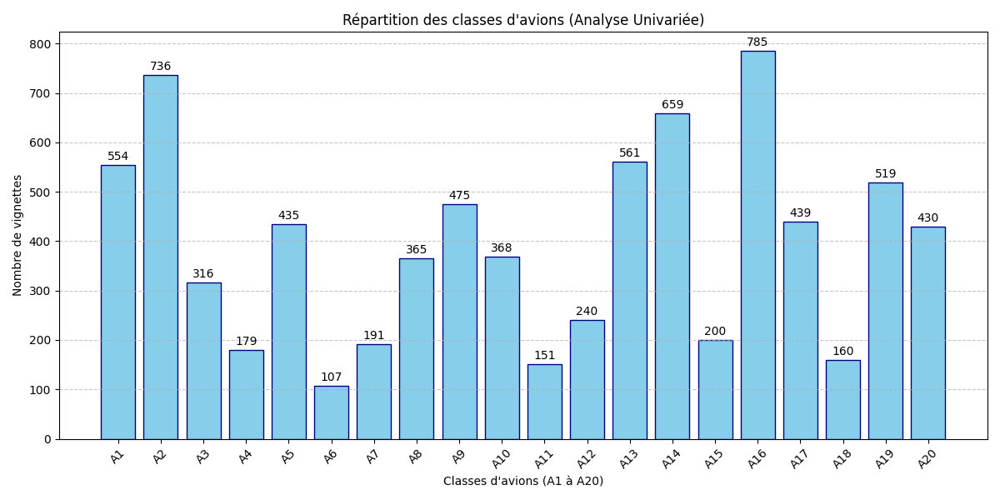

# Détection et classification d'avions militaires (Faster R-CNN)

Projet d'IA réalisé en B2 : détecter et classer **20 types d'avions militaires (A1 à A20)** sur des images aériennes, avec un modèle **Faster R-CNN (backbone ResNet50-FPN)** pré-entraîné sur COCO puis affiné sur notre jeu de données.



## Pipeline

1. **Exploration des données** : comptage des objets annotés (`somme.py`), répartition des classes (`analyse.py`), recherche de doublons par hash MD5 (`doublon.py`).
2. **Extraction des vignettes** : découpage de chaque avion selon ses boîtes englobantes XML (format Pascal VOC), avec gestion des images `.jpg`/`.png` (`main.py`, `erreur.py`). Résultat : 7 870 vignettes.
3. **Découpage des données** : split 80/20 train/val (`repartitions.py`) et validation croisée stratifiée en 5 folds (`k-fold.py` → `Classification/dataset_kfold.csv`).
4. **Détection** (`Classification/`) :
   - `dataset.py` : `Dataset` PyTorch qui lit les images et les annotations XML.
   - `model.py` : Faster R-CNN ResNet50-FPN avec une tête de 21 classes (20 avions + fond).
   - `train.py` : fine-tuning (SGD, lr 0,0005, momentum 0,9, 7 époques).
   - `eval.py`, `metrics.py` : précision, rappel et F1 (IoU ≥ 0,5).
   - `confusion.py` : matrice de confusion détection + classification.
   - `detection.py` : dessine les boîtes prédites sur un lot d'images.
   - `eval_prof.py` : produit les prédictions officielles au format JSON (`predictions_officielles.json`).

## Technologies

Python · PyTorch · torchvision · OpenCV · scikit-learn · pandas · Matplotlib · Seaborn · Google Colab (GPU)

## Utilisation

```bash
pip install torch torchvision opencv-python scikit-learn pandas matplotlib seaborn tqdm pillow
```

Les scripts de `Classification/` sont prévus pour Google Colab : changez `BASE_PATH` pour pointer vers votre dossier. Il doit contenir `images/`, `annotations/` et les poids du modèle `faster_rcnn_avions.pth`.

> Le jeu de données (images et annotations) et les poids entraînés ne sont pas inclus dans ce dépôt.
